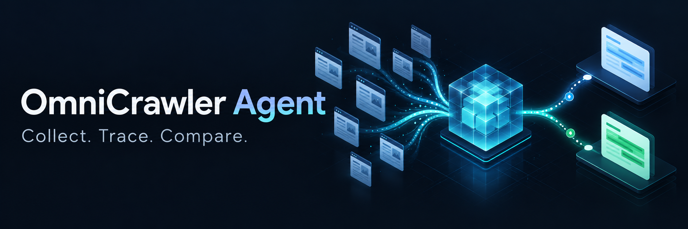

<p align="center">
  
</p>

<p align="center">
  <strong>采集有边界 · 字段有来源 · 变化有证据</strong><br />
  本地优先的数据采集、证据追踪与变化监控 Agent
</p>

<p align="center">
  <a href="https://github.com/zolo1978/omnicrawler-agent/actions/workflows/ci.yml"></a>
  <a href="LICENSE"></a>
  
  
</p>

<p align="center">
  <a href="#快速开始">快速开始</a> ·
  <a href="#工作方式">架构</a> ·
  <a href="docs/usage.md">使用文档</a> ·
  <a href="docs/plans/2026-10-11-omnicrawler-roadmap.md">路线图</a> ·
  <a href="CONTRIBUTING.md">参与贡献</a>
</p>

## 为什么做 OmniCrawler？

同一份商品列表，今天价格变了、明天新增条目、后天下架。OmniCrawler 把指定来源整理成结构化记录，为每个字段保存 URL、时间和定位证据，再对可比的完整快照检测变化。你可以追问“哪里变了”，也可以核对“根据什么”。

适用于授权网页的目录监控、公开信息追踪和规则采集。它交付的是**可审计的答案**：每条结论都能点回原文、给出定位、原样复现，并声明本次采集的覆盖范围——这是通用问答无法给出的东西。默认需要明确 URL、字段及 CSS 定位；配置搜索或模型后端后可提名来源、生成受证据约束的推断，但两者都只能提名、不能扩大授权范围。

## 已实现的能力

| 能力 | 当前行为 |
| --- | --- |
| 受控采集 | 精确域名范围、DNS/重定向检查、robots、限速及响应预算；拒绝访问后停止；429/5xx 有界重试并遵守 Retry-After |
| 来源证据 | 字段关联 URL、时间、定位和最小片段；保留多来源冲突并标注来源独立性 |
| 抽取韧性 | 字段选择器备选链（含元素自身文本）；单字段失效降级为 warning 而非整页归零；已记录实体不再解析时判为不完整而非删除 |
| 分页与覆盖口径 | next 选择器或 URL 模板分页，受页预算约束；报告给出 计划/实际抓取、截断状态；错误与警告均为含 code/url/message/retryable 的对象 |
| 变化检测 | 新增、修改、删除；只有覆盖范围可比的完整快照才推断删除；引擎按覆盖范围固化，换机器不重置基线 |
| 答案综合 | 交付前可用模型生成推断，每条推断必须引用本次运行已存的证据；任何一条引用无法命中已存证据，整条推断被丢弃；未配置时明确标注未启用 |
| 来源提名 | 可接 SearXNG 兼容搜索后端提名候选来源；候选必须落在白名单内并经人工采纳，搜索只是提名渠道 |
| 持续运行 | SQLite 持久化、APScheduler 计划、暂停/恢复、幂等提交与取消 |
| 引导与入口 | 一次性/长期问卷、采样提案、版本确认；CLI、API Key REST、MCP stdio |
| 多格式交付 | 统一证据报告输出 Markdown、Word、PDF、JSON；缺失字体/依赖时明确降级 |
| 原文回放 | 可选留存原始响应（内容哈希去重、随快照清理），`omnicrawler replay` 按快照与 URL 回放 |
| 留存清理 | 结构化数据默认 90 天；启动及每日清理；按实体或来源删除，原文一并清理 |

## 工作方式

```mermaid
flowchart LR
    N[搜索提名<br/>仅提名不授权] -.->|人工采纳| A
    A[明确 URL / 字段 / 定位] --> B[授权范围与访问策略]
    B --> C[受控 HTTP 获取]
    C --> D{内容处理路径}
    D --> E[HTML / Crawl4AI 解析验证]
    D --> F[Playwright 离线内联渲染]
    E --> G[CSS 字段抽取 + 来源证据]
    F --> G
    G --> H[(SQLite 快照)]
    H --> I[完整且覆盖范围可比]
    I --> J[新增 / 修改 / 删除 + 前后证据]
    J --> S[证据约束推断<br/>可选模型，引用须命中已存证据]
    S --> K[CLI · REST · MCP]
    style B fill:#123047,stroke:#38bdf8,color:#e2e8f0
    style H fill:#123047,stroke:#2dd4bf,color:#e2e8f0
    style J fill:#123047,stroke:#2dd4bf,color:#e2e8f0
    style S fill:#123047,stroke:#38bdf8,color:#e2e8f0
```



Crawl4AI 当前是 **HTML 字段抽取加解析验证**，不承担 LLM 语义抽取。模型只参与来源提名与报告推断，且两者都不能扩大已授权的来源范围。Playwright 当前支持受限内联脚本，网络依赖型 SPA、登录和验证码流程尚未支持。详细边界见 [使用说明](docs/usage.md)。

## 快速开始

需要 Python 3.12 或 3.13，以及 uv。CI 在 ubuntu / windows / macos × Python 3.12/3.13 上运行；本地开发在 Windows 与 macOS ARM64 上验证过。

```sh
git clone https://github.com/zolo1978/omnicrawler-agent.git
cd omnicrawler-agent
uv sync --locked --extra crawl4ai --python 3.12
PLAYWRIGHT_BROWSERS_PATH="$PWD/.browser-cache" uv run --extra crawl4ai playwright install chromium
uv run --extra crawl4ai omnicrawler demo --output data/demo
```

演示启动临时本地 HTTP 站点并连续采集三次；报告输出到 `data/demo/report.md`。它不访问外部业务网站。

| 快照 | 站点状态 | 检测结果 |
| --- | --- | --- |
| ① 基线 | A：79，B：20 | 建立基线 |
| ② 更新 | A：89，B：20，C：129 | A 改价、C 新增 |
| ③ 更新 | A：89，C：129 | B 删除 |

采集授权来源时，复制 [示例配置](examples/collection.json)，填写实际 URL、域名与字段定位后执行：

```sh
uv run --extra crawl4ai omnicrawler collect examples/collection.json --db data/agent.sqlite
```

示例中的 `example.com` 是占位来源，需替换。REST、MCP 和定时计划的配置见 [运行文档](docs/usage.md)。

## 引导采集与报告

```sh
uv run --extra crawl4ai omnicrawler guide --allow-host example.com
# 中断后恢复：增加 --session-id <会话ID>，使用同一数据库
```

向导先区分一次性采集与长期监控，再询问目标、URL、字段与范围。采样提案需主动接受，草案需最终确认；未知项未解决时不能执行。长期监控立即交付基线，持续运行需启动同一数据库的 REST/MCP worker。

报告包含来源、字段证据、冲突观察、事实/推断分区、覆盖口径（计划/实际抓取、截断）以及本次运行的错误与警告。推断分区默认标注未启用；配置 `OMNICRAWLER_PROVIDER_URL` 与 `OMNICRAWLER_PROVIDER_MODEL` 后由模型生成，且每条推断必须引用本次运行已存储的证据（url + 定位精确匹配）——任何一条引用命中不了，整条推断被丢弃，不做修剪。PDF 使用离线 Chromium 和 CJK 字体；Linux 安装 `fonts-noto-cjk`。配置 provider、搜索提名、会话 REST/MCP 和导出示例见 [引导与报告说明](docs/guided-and-reporting.md)。

## 验证与开发

```sh
uv run --extra crawl4ai pytest -q
uv run --extra crawl4ai ruff check src tests tools
uv run --extra crawl4ai ruff format --check src tests tools
uv build
```

测试覆盖真实本地 HTTP、三个处理模式、REST worker、MCP stdio 握手、访问拒绝、重试与 Retry-After、快照差异、抽取韧性与分页、引擎固化、原文回放、调度及删除。`tests/fixtures/corpus/` 另存 12 个真实公开页面（5 个域名）与 8 个脏数据变体，离线重放，用于验证真实标记下的抽取质量；`tools/record_corpus.py --refresh` 可重新录制。CI 徽章反映 GitHub Actions 的实际状态；本地验证与尚未实证的范围见 [验证记录](docs/validation/2026-10-12-product-upgrade.md)。

## 路线图与贡献

下一阶段重点是文档解析、更多采样建议和规模化适配（并发抓取、告警通知）。候选工具源码已获取作本地研究，出现在清单中不代表已经接入。

- [项目规划](docs/plans/2026-10-11-omnicrawler-roadmap.md)
- [执行记录](docs/plans/2026-10-11-foundation-execution.md)
- [贡献指南](CONTRIBUTING.md)
- [第三方依赖](docs/third-party-dependencies.md)

## 许可证

原创代码与文档采用 [Apache-2.0](LICENSE)，项目声明见 [NOTICE](NOTICE)。第三方依赖保留各自许可；参考原稿、上游研究源码、采集数据、凭据和浏览器缓存均不纳入仓库。
