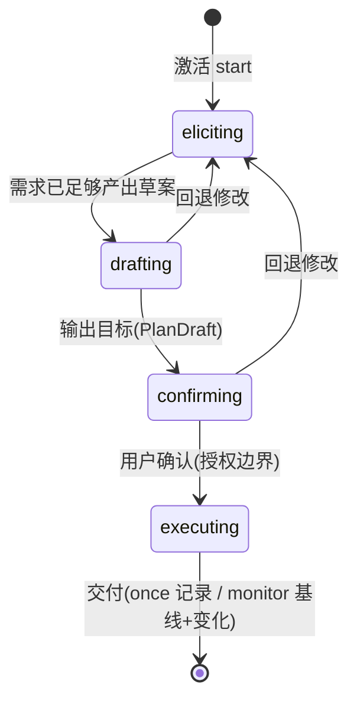
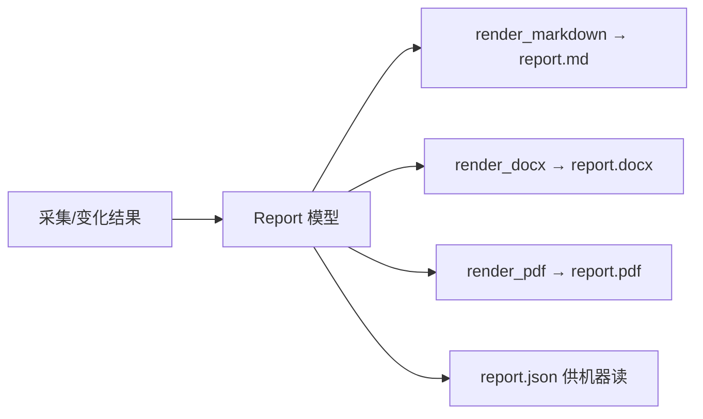

# 引导式交互与多格式交付：整体方案与实施计划

日期：2026-10-11。状态：已授权实施。范围：在已交付的本地 MVP 之上，新增「引导式交互」与「多格式交付」两个能力。原文属于规划阶段；所有者随后明确要求执行，实施状态见 guided-reporting-execution 记录。

---

## 1. 背景与现状

MVP 已交付并开源（Apache-2.0），Linux CI 首次实际运行通过，核心能力包括：受控采集、字段证据、快照与变化检测、定时任务、REST/MCP 入口、留存清理。

当前两处短板，构成本阶段目标：

| 现状 | 问题 |
|---|---|
| 交互是**声明式** | 调用方必须自带完整 `CollectionConfig`（URL、CSS 选择器、ID 属性），否则无从下手 |
| 交付是**JSON/CSV + demo 的 MD** | 无 Word/PDF；报告仅 demo 脚本产出，未沉淀为通用交付能力 |

交互现状证据：CLI `collect`、REST `/plan`、`/tasks`、MCP `create_task` 均要求完整配置；唯一的 `plan_with_provider` 未接入真实 provider，且要求 LLM 一次性返回含 CSS 的完整配置（不可靠）。

本阶段**不追求**：一句话全网自动调研、SPA/登录/验证码、百万页容量。这些仍属后续阶段或明确不做。

---

## 2. 目标

1. **引导式交互**：五步流程 `激活 → 询问需求 → 输出目标 → 用户确认 → 执行交付`。
2. **任务分型**：首问区分「一次性任务」与「长期监控任务」，并据此改变后续必填项与交付契约。
3. **多格式交付**：同一份报告输出 `Markdown / Word / PDF`（另保留 `JSON` 供机器读取）。
4. **安全不变量不放松**：引导不是自动突破，每一步扩展范围（host/字段/频率）都需显式确认，且继续走现有 `SafeFetcher` + allowlist + robots + 限速边界。

---

## 3. 总体方案

### 3.1 引导式交互：五步状态机



五步与状态对应：

| 步骤 | 状态 | 动作 | 产出 |
|---|---|---|---|
| 激活 | start | `POST /sessions` / `start_session` / `omnicrawler guide` | 会话 ID + 首批问题 |
| 询问需求 | eliciting | 结构化问卷，分轮提交回答 | 答案集 + 待补项 |
| 输出目标 | drafting | 回显受约束计划 | `PlanDraft`（含未知项标注） |
| 用户确认 | confirming | 校验并锁定 | `CollectionConfig` 或 `CollectionConfig + Schedule` |
| 执行交付 | executing→done | 入队/注册计划，产出多格式报告 | 记录或基线/变化报告 |

会话对象 `GuidanceSession` 持久化到 SQLite，支持中断恢复；确认动作是可审计的授权记录。

### 3.2 首问分型：一次性 vs 长期

首问必须锁定 `task_type`，因为它是后续所有分支的岔路口：

| 维度 | 一次性 (once) | 长期 (monitor) |
|---|---|---|
| 必填项 | goal / source / fields | goal / source / fields / **frequency** |
| 产出 | 一次结构化记录 + 证据 | 基线 + 每周期变化报告 |
| 交付契约 | "现在有什么" | "变了什么" |
| 额外要求 | 无 | 需稳定实体 ID（否则变化检测不可靠，引导阶段即提醒） |
| 落地对象 | `TaskService.enqueue` | `TaskService.schedule` |

### 3.3 询问需求：结构化问卷

内部是**可校验的问卷**（外部可渲染成对话），分轮、容忍部分回答，缺项显式标记而非卡死：

| 轮 | key | 问什么 | 类型 | 说明 |
|---|---|---|---|---|
| 1 | `task_type` | 一次性采集还是长期监控？ | choice | 首问分型 |
| 2 | `goal` | 你想得到什么？ | text | 稍后回显确认 |
| 3 | `source` | 数据从哪来？（种子 URL / 搜索主题） | url/list | goal-only 时是主要缺口 |
| 4 | `fields` | 关注哪些字段？ | list | 名字 + 想找什么 |
| 5 | `frequency` | 多久检查一次？ | choice/number | 仅 monitor，≥10s |
| 6 | `scope` | 确认采集范围仅限这些域名 | choice | 授权边界回显 |

问卷 schema：

```python
class Question(BaseModel):
    key: str
    prompt: str
    kind: Literal["choice", "text", "list", "url"]
    required: bool
    options: list[str] | None = None
```

### 3.4 输出目标：`PlanDraft`

不是复述一句话，而是回显一个**可校验、可修改、带未知项标注**的受约束计划：

```python
class PlanDraft(BaseModel):
    goal: str                          # 回显确认理解一致
    task_type: Literal["once", "monitor"]
    sources: list[str]
    allowed_hosts: list[str]           # 授权域名
    proposed_fields: dict[str, str]    # 字段名 -> 选择器（preview 前可为空）
    schedule_seconds: int | None       # 仅 monitor
    budget: int
    unknowns: list[str]                # 显式缺口，如"选择器待采样确认"
    preview: PreviewResult | None
    deliverable_formats: list[str] = ["md", "pdf", "docx", "json"]
    status: Literal["draft", "confirmed"]
```

**草案可带未知项，但带未知项不能确认。**

### 3.5 用户确认：授权边界

```python
confirm(draft)
  ├─ once     → CollectionConfig → TaskService.enqueue()
  └─ monitor  → CollectionConfig + seconds → TaskService.schedule()
```

确认规则：
1. `draft.allowed_hosts ⊆ 服务启动白名单`，否则拒绝（复用 `authorize()`）。
2. `unknowns` 非空 → 不能确认。
3. 幂等：同一 draft 重复确认返回同一 task/schedule id。
4. 确认写入审计记录（谁、何时、确认了什么范围）。

---

## 4. 交付格式方案

### 4.1 单一数据源 + 三渲染器



```python
class Report(BaseModel):
    title: str
    generated_at: AwareDatetime
    goal: str
    task_type: Literal["once", "monitor"]
    summary: dict                     # 实体数 / added / modified / removed
    records: list[dict]               # entity_id + fields + 证据引用
    changes: list[dict]               # kind + before/after + 证据
    sources: list[str]
    schedule_seconds: int | None
    facts: list[str]                  # 事实
    inferences: list[str]             # 推断（显式标记）
```

渲染器只负责排版，不碰业务逻辑；**证据、来源、事实/推断标注在三种格式里都必须保留**。

### 4.2 选型与许可

| 格式 | 方案 | 依赖 | 许可 | CJK |
|---|---|---|---|---|
| MD | 原生生成 | 无 | — | ✅ |
| Word | `python-docx` | 纯 pip，无系统依赖 | MIT ✓ | ✅ |
| PDF | HTML 模板 → Playwright `page.pdf()` | **复用已有 Playwright**，零新增 Python 依赖 | Apache-2.0 ✓ | ⚠️ 需 CJK 字体 |

PDF 候选对照：WeasyPrint（BSD，但需 pango/cairo 系统库）、reportlab（BSD，但需手工注册 CJK TTF）、fpdf2（LGPL-3.0，需按实际链接与再分发方式评估义务）、Pandoc（GPL 外部二进制 + PDF 需 LaTeX）。**推荐复用 Playwright**：已是依赖、可离线打印、与新引库相比风险最小。

`python-docx` 需登记进 `config/upstreams.json`（MIT），按现有许可审查流程走。

### 4.3 CJK 字体风险（PDF 最大风险）

报告几乎必然含中文；字体不对会渲染成豆腐块。对策：
1. macOS 用系统苹方；Linux CI / 容器显式安装 `fonts-noto-cjk`。
2. 加一条**真实中文字符渲染测试**：用含中文的 `Report` 生成 PDF，断言 PDF 含目标文本，不能只看"非空文件"。
3. 字体缺失时**降级并明确告知**（"PDF 需 Noto CJK，本次仅交付 MD/Word"），不吐豆腐块 PDF。

### 4.4 内容规范

- 字段值用已脱敏值（现有 `sanitize()`），证据 excerpt 已截断 2000 字符，**不塞原始 HTML**。
- 变化报告 `before → after + 证据`；"可能意味着…"归入 `inferences`。
- 报告文件落在 `data/reports/{task_id}/`（`data/` 已忽略，不入库）。

### 4.5 降级策略

格式缺失**不阻断任务本身**：`python-docx` 未装 → 交付 MD+PDF+JSON 并提示；PDF 字体缺失 → 同上降级。采集与变化检测照常完成。

---

## 5. 架构与模块

新增两个模块，**坐在现有原语之上，不侵入核心采集逻辑**：

```text
src/omnicrawler/
  session.py     # GuidanceSession 状态机 + 问卷 + PlanDraft + confirm
  report.py      # Report 模型 + render_markdown/render_docx/render_pdf
  planner.py     # 复用：plan / plan_with_provider（草案生成）
  pipeline.py    # 复用：CollectionConfig / collect
  service.py     # 复用：TaskService.enqueue / schedule
  policy.py      # 复用：SafeFetcher 安全边界
  api.py         # 新增 /sessions/*、/reports/*
  mcp_server.py  # 新增 start_session 等工具
  cli.py         # 新增 guide 命令
```

---

## 6. 接口设计

### 6.1 REST

| 方法与路径 | 用途 |
|---|---|
| `POST /sessions` | 激活，返回 session_id + 首批问题 |
| `POST /sessions/{id}/answer` | 提交回答，返回下一批问题或 draft |
| `GET /sessions/{id}/draft` | 查看草案 |
| `POST /sessions/{id}/confirm` | 确认，返回 task_id 或 schedule_id |
| `GET /tasks/{id}/report?format=md|pdf|docx|json` | 按格式导出报告 |

`/sessions/*` 与 `/reports` 全部鉴权（复用 `authenticate`），`/health/live` 仍匿名。

### 6.2 MCP

新增工具（上游 Agent 用自己的 LLM 驱动引导循环，OmniCrawler 只给原语）：

```text
start_session / answer_questions / get_draft / confirm_session
```

现有 `create_task / task_status / task_result / cancel_task / list_changes` 保留。MCP 场景下**引导者是调用方 Agent**，OmniCrawler 提供可组合原语而非拥有对话。

### 6.3 CLI

新增 `omnicrawler guide`：交互式向导，逐步 `print + input`，落到 `data/` 与报告文件。

---

## 7. 安全与合规不变量

1. 引导各阶段（preview/draft/采集）用**完全相同**的 `SafeFetcher`（allowlist、robots、SSRF、限速、拒绝即停）。
2. goal-only 请求无法被现有 allowlist 约束时，返回结构化的"还需补充哪些信息"，**不自行扩大范围去猜**。
3. 选择器建议是**提案**，永不自动应用去新增字段或 host；确认步骤才是授权边界。
4. LLM/provider 输出经 Schema + 来源范围校验后**仍不可**绕过 allowlist（现有 `plan_with_provider` 校验保留）。
5. 报告字段已脱敏，不输出凭据、Cookie、原始 HTML、敏感个人信息。
6. 页面与文档内容属不可信输入，不得影响工具调用权限或扩大采集范围。

---

## 8. 实施计划（分期）

### 任务表

| 编号 | 任务与主要交付 | 依赖 | 验收条件 |
|---|---|---|---|
| RP01 | `Report` 模型 + `render_markdown` + 单元测试 | 无 | 给定结果生成含证据、事实/推断分区的规范 MD；字段缺失/空报告有明确行为 |
| RP02 | CLI 与 demo 复用 `Report` 输出规范 MD | RP01 | demo 产出 `report.md` 结构稳定，与现有 JSON 一致 |
| GD01 | `GuidanceSession` 状态机 + SQLite 持久化 | 无 | 状态转换受控、可中断恢复、非法转换被拒绝 |
| GD02 | 结构化问卷 schema + 首问 once/monitor 分叉 | GD01 | 分叉正确；缺项显式标记不卡死；choice/url 非法输入被拒 |
| GD03 | `PlanDraft` 生成 + `unknowns` 标注 | GD02 | 草案回显目标、域名、字段、频率；缺口进 unknowns；带 unknowns 不能确认 |
| GD04 | `confirm` 边界（draft → enqueue/schedule） | GD03 | 越权 host 被拒；幂等返回同一 id；monitor 需稳定 ID 否则提醒 |
| GD05 | REST `/sessions/*` + MCP 四工具 + CLI `guide` | GD04 | 三入口走通五步；鉴权生效；MCP 工具可编排 |
| RP03 | `render_docx`（python-docx）+ 依赖登记 | RP01 | 表格/标题/证据完整；CJK 正常；`upstreams.json` 登记 MIT |
| RP04 | `render_pdf`（HTML + Playwright）+ CJK 字体验证 | RP01 | 离线打印成功；含中文断言通过；字体缺失降级并提示 |
| RP05 | `deliverable_formats` 接入 PlanDraft 与交付步骤 | RP03, RP04, GD04 | 确认后按格式写文件；格式缺失降级不阻断任务 |
| GD06 | `preview` 采样预览（确定性选择器建议） | RP01 | 输入 url+allowlist 返回候选 item/id/字段选择器 + 抽样证据；走 SafeFetcher；不放松边界 |
| GD07 | `plan_with_provider` 两步化 + 真实 provider 接入 | GD06 | 目标→候选源→草案闭环；LLM 输出经校验仍不能扩大授权 |

### 里程碑与估算

| 里程碑 | 组成 | 人日（单名熟悉 Python 开发者） |
|---|---|---|
| MG1 引导闭环 + MD 交付 | RP01/RP02/GD01–GD05 | 6–9 |
| MG2 三格式交付 | RP03/RP04/RP05 | 3–5（CJK 字体是变量） |
| MG3 采样预览 | GD06 | 2–3 |
| MG4 自然语言闭环 | GD07 | 3–6（依赖 provider/搜索决策） |

以上为粗估、不是交付承诺；兼容性与真实 provider 接入后再重新估算。MG1 完成后即具备"引导式 + MD 交付"的可用形态，MG2 补齐 PDF/Word，MG3/MG4 降低门槛并打通自然语言。

### 执行顺序建议

```
MG1（先做，价值最高、无 LLM、低风险）
  → MG3（确定性 preview，进一步降低配置门槛，仍无 LLM）
  → MG2（多格式交付，可与 MG3 并行）
  → MG4（接 LLM/搜索，外部依赖，最后）
```

每个业务任务先写行为失败测试，再实现并复验；新增依赖按现有 `config/upstreams.json` 流程登记许可。

---

## 9. 风险与待决策

- **CJK 字体**是 PDF 唯一硬骨头，用真实中文字符渲染测试兜底；Linux 容器字体策略需在 MG2 前定。
- **引导 vs 安全的张力**：核心风险是"引导"被理解成"自动爬"；通过确认边界、未知项阻断、allowlist 子集校验三条守住。
- **LLM/搜索 provider 与预算未指定**：MG4 依赖外部决策，通过接口隔离，MG1–MG3 不受其阻塞。
- **选择器建议质量**：启发式可能给出错误候选；preview 只是提案，最终以用户确认的配置为准，错误候选不会扩大授权。
- **交付文件体积**：PDF/Word 含证据后可能偏大；报告默认用最小证据片段（已截断），全文证据仍在 SQLite 可查，避免重复膨胀。

---

## 10. 关联文档

- [路线图](2026-10-11-omnicrawler-roadmap.md)
- [执行记录](2026-10-11-foundation-execution.md)
- [安全采集 ADR](../adr/0002-safe-collection-mvp.md)
- [使用说明](../usage.md)
- [验证记录](../validation/2026-10-11.md)
