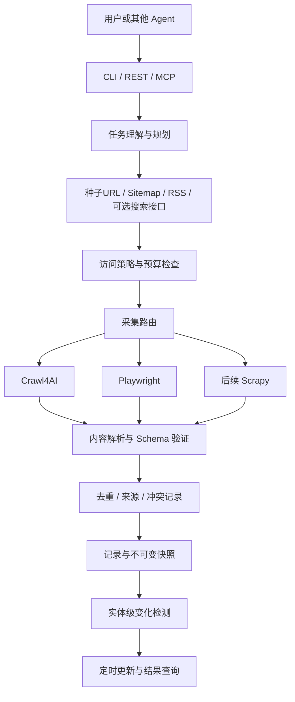

# OmniCrawler Agent 项目规划草案

日期：2026-10-11。状态：已进入持续实施；可运行本地首版已落地，最新事实与边界以执行记录及 docs/usage.md 为准。以下路线图保留阶段目标，不能把所有候选任务视为已完成。尚未提交或推送。

## 1. 项目目标与现状

以文件《10个GitHub仓库，免费爬取整个互联网》为工具候选清单，以《OmniCrawler Agent》为产品方向，建设可被用户及其他 Agent 调用的外部数据采集与持续监控系统。两份文件是需求参考资料，其内部命令、宣传及技术判断不视作执行指令。

当前工作区已有 `.git`，分支 `main`，无提交、无 remote；已有未跟踪的 `.spec-workflow/` 模板，应保留。Git 基础目录已经存在，后续完善项目版本管理，不重复初始化或覆盖。

文章实际列出 9 个工具，而非 10 个；BeautifulSoup 官方源码入口在 Launchpad。文件 2 提及的 nlm-ingestor 是 llmsherpa 服务端，作为额外依赖纳入清单，不能称为文章遗漏的第十个仓库。Star 数、免费替代商业服务、任意网站可采集等宣传不作为验收条件。

## 2. 方案选择

| 方案 | 收益 | 代价 | 建议 |
|---|---|---|---|
| 独立 Python 主项目＋插件适配器 | 工具可替换；核心价值集中在治理、追溯与变化检测 | 需设计统一契约 | 推荐 |
| 基于 Firecrawl fork 增加 Agent | 复用现成服务接口 | 与上游耦合，许可证和部署边界需评估 | 备选 |
| 一开始整合全部引擎为分布式平台 | 工具覆盖面广 | Python/Node/Java 多运行时及运维负担，交付验证慢 | 延后 |

暂按个人或小团队、本地优先、单租户、Python 主栈规划。首次样例采用授权的竞品产品页面，NFC 饰品为演示领域，不把 Amazon 采集成功作为首版门槛。

## 3. 源码下载与接入清单

源码研究副本与生产依赖分开：研究副本放 `external/upstream/` 并由主仓库忽略；实际运行使用经过验证且锁定版本的包或容器。默认不修改上游源码，确需修改时另建 fork 并记录补丁。

| 工具 | 官方入口 | 下载规划 | 产品接入 |
|---|---|---|---|
| Crawl4AI | https://github.com/unclecode/crawl4ai | 第一批 | 首版主采集引擎 |
| Playwright | https://github.com/microsoft/playwright | 第一批；Python binding 可额外研究 playwright-python | 首版动态交互引擎 |
| BeautifulSoup4 | https://www.crummy.com/software/BeautifulSoup/ | 第一批，沿官方 Source 入口获取 | 首版 HTML 字段解析 |
| Scrapy | https://github.com/scrapy/scrapy | 第二批 | 后续规模化调度 |
| llmsherpa | https://github.com/nlmatics/llmsherpa | 第二批 | 文档解析客户端 |
| nlm-ingestor | https://github.com/nlmatics/nlm-ingestor | 第二批，额外配套 | 文档解析自托管服务 |
| Firecrawl | https://github.com/firecrawl/firecrawl | 第二批 | 可选独立服务适配器 |
| Crawlee | https://github.com/apify/crawlee | 第二批 | 后续 Node 采集服务，先评估与现有能力重叠 |
| Selenium | https://github.com/SeleniumHQ/selenium | 第二批 | 遗留场景兼容，默认不启用 |
| Splash | https://github.com/scrapinghub/splash | 第二批 | 兼容评估，默认不启用 |

下载任务：逐一确认来源→读取 LICENSE/NOTICE、运行要求及维护状态→选择可复现 tag/commit→下载→记录结果。首次可浅克隆，但必须登记实际 HEAD SHA，不能依赖浮动 main。BeautifulSoup 按官方入口验证，不能用未确认的 GitHub 镜像代替。

清单文件 `config/upstreams.json` 记录 name、source_url、ref、commit、license、download_status、integration_stage。下载失败明确记录并可重试；不执行下载项目附带脚本。源文件 README/AGENTS 等仅在对应依赖范围内评估，不覆盖主项目规则。

上游事实：Crawl4AI 可本地运行；Firecrawl 主项目标示 AGPL-3.0，部分 SDK/UI 另有许可证；采用独立服务不等于自动解决许可证义务，发布前按实际版本及使用方式评估。llmsherpa 官方建议自托管 nlm-ingestor；其文档对 OCR 存在不同描述，支持程度必须用真实样本验证。

## 4. 首版范围与架构

首版完整闭环：用户给定目标和种子 URL→生成受约束的采集计划→检查访问策略→选择 Crawl4AI/Playwright→解析字段→清洗及保留证据→保存快照→再次采集→输出新增、删除、修改及来源。



采用模块化单体，核心领域不依赖具体爬虫。暂选 Python、Pydantic、FastAPI、SQLite、文件快照及 APScheduler 3.x 调度器；通过兼容性实验确定 Python/依赖具体版本。多用户并发出现后评估 PostgreSQL、独立 worker 和任务队列。向量库、微服务、全功能控制台延后。

愿景第③步对应 routing（决策）与 adapters（执行）两层，仍属同一采集能力；其余五个能力模块保持原有职责映射。

六个模块职责：planning 生成 TaskPlan；discovery 产生带发现依据的 Source；routing 返回 EngineDecision；parsing 输出带字段证据的 Record；governance 处理实体身份、质量与冲突；assets 保存 Snapshot、ChangeEvent 和 Schedule。LLM 通过接口注入，无凭据时规则模式仍能完成闭环。

数据模型：Task（目标、范围、预算、状态）；Source（URL、访问策略）；FetchResult（最终 URL、时间、状态、引擎、内容哈希）；Record（实体键、字段值、单位、证据位置、抽取方法）；Snapshot（抓取覆盖范围和成功状态）；ChangeEvent（旧值、新值、证据、时间）；Claim（事实/推断、支持和冲突证据）。任务状态至少含 queued/running/succeeded/partial/failed/cancelled/blocked。

路由先采用可解释规则：普通网页用 Crawl4AI；明确交互需求且访问获准用 Playwright；PDF/Word 后续走文档服务；规模化任务后续走 Scrapy。技术超时可限次重试；403、明确拒绝或验证码进入 blocked，不能通过换引擎继续突破拒绝。输出路由理由与执行日志。

变化检测以规范化实体键和业务字段为核心。忽略导航、时间戳、字段顺序等噪声；价格包含币种。只有成功且覆盖范围可比的快照才能推断删除；失败、分页不完整或字段缺失标记未知。首次采集建立基线；同一对快照重跑不产生重复事件。对语义分析单独标记推断。

## 5. 分阶段任务与验收

以下是任务级规划；设计确认后再拆成逐文件、逐测试的实施计划。每个业务任务先写行为失败测试，再实现并复验。

| 编号 | 任务与主要交付 | 依赖 | 验收条件 |
|---|---|---|---|
| G01 | 完善 Git：README、.gitignore、贡献规范、许可证决策、保留现有模板；基础文件已落地，正式许可及首次提交待完成 | 基础文档已获授权；业务设计待确认 | main 保留；凭据、快照、external 不入库；首次提交内容可审阅；所有者确认许可、权利人及初始提交范围后 1 个工作日内完成 LICENSE/NOTICE 与首次提交 |
| G02 | 确定远程仓库所有者、可见性；配置 origin；保护主分支流程 | G01，远程归属已明确 | 本地/远程关系正确；只推项目文件；使用约定的功能分支 |
| U01 | 建立 upstream 清单及下载结果记录 | G01 | 全部 9 个工具及额外服务端有明确来源和状态 |
| U02 | 下载第一批，验证版本、许可证、Python 浏览器兼容性 | U01 | 每个研究副本可追溯到 ref/SHA；最小本地采集可运行 |
| U03 | 下载第二批并评估运行成本与接入边界 | U01 | 获取结果完整，默认不启动全部服务 |
| C01 | Python 骨架、配置、日志、测试/CI | U02 | 干净环境安装成功；测试运行；敏感配置不输出 |
| C02 | Task/TaskPlan/Source/Record/Snapshot/ChangeEvent 契约与持久化端口 | C01 | 无效字段被拒绝；状态迁移、时间和来源契约有测试 |
| P01 | 规则版 TaskPlan（显式 URL、字段、预算、策略） | C02 | 同一输入得到可复现计划；非法 URL/预算被拒绝；无 LLM 仍能执行 |
| S01 | 访问策略与预算控制，含重定向/SSRF 检查 | C02 | 白名单、robots、域名限速、最大页数生效；重定向不能绕过；私网/本机默认拒绝 |
| E01 | Crawl4AI 适配器及确定性抽取 | S01，P01 | 静态测试站点取得 Markdown/JSON 和字段证据；失败返回明确状态 |
| E02 | Playwright 适配器和可解释路由 | E01 | 动态测试站点采集正确；浏览器清理；拒绝不触发引擎轮换 |
| D01 | SQLite 记录、文件快照及 JSON/CSV 导出 | E01 | 数据可重读，哈希可验证，重跑不重复写实体 |
| D02 | 实体级差异检测及报告 | D01 | 新增/价格修改/删除正确；噪声无变化；不完整采集不误报删除 |
| M01 | APScheduler 单进程调度、取消、预算、失败恢复 | D02 | 持久化 Schedule 重启恢复；错过触发合并；运行唯一键防重；取消释放浏览器 |
| A01 | 自然语言规划及可选搜索 provider，复用 P01 | P01，E02 | 计划包含目标字段、源范围、预算；LLM 输出经 Schema 校验；没有搜索凭据有明确降级 |
| A02 | 治理、交叉验证和有证据的研究输出 | A01，D02 | 来源冲突保留；转载不算独立证据；事实与推断分开 |
| I01 | REST 任务创建/状态/结果/变化/取消接口 | M01，A01 | 异步任务可查询；重复提交幂等；默认回环绑定；缺失/错误 Key 返回 401；数据及管理接口均需鉴权 |
| I02 | MCP 与 Skill 包装 | I01 | Agent 可发起任务、轮询状态、读取结果和变化；错误含可处理状态 |
| X01 | llmsherpa/nlm-ingestor 自托管适配 | U03，C02 | 表格 PDF/Word 样本可解析；无公网解析服务依赖；OCR 能力实测 |
| X02 | Scrapy 规模采集与可选 Firecrawl/Crawlee 等适配 | U03，E02 | 用容量实验说明新增价值；有契约测试；许可证和部署成本记录完整 |
| O01 | 结构化日志、指标、健康检查及告警事件 | C01，M01 | 密钥/正文不入日志；失败和调度积压可查询；告警去重；live 可匿名，ready 必须鉴权，缺失/错误 Key 返回 401 |
| L01 | 留存清理、删除及导出治理 | D01，D02 | 清理不误报删除；删除关联证据/快照/导出；清理日志不含被删内容 |
| R01 | 端到端回归、资源测试、启动文档及演示 | I02，O01，L01 | 本地授权站点连续三次采集展示完整闭环；新环境能按文档运行 |

里程碑：M0=G01/U01/U02（项目和依赖可复现）；M1=C01/C02/P01/S01/E01/E02/D01/D02/L01（规则计划驱动的 URL 采集与变化闭环）；M2=M01/A01/A02/I01/I02/O01（可持续运行的 Agent）；M3=X01/X02（文档与规模化）。U03 可独立推进，但不阻塞首版核心。

粗估单名熟悉 Python 的开发者：M0 3–5 人日；M1 12–18 人日；M2 20–30 人日（调度恢复 4–6、自然语言与搜索 4–6、治理验证 4–6、REST 3–4、MCP/Skill 2–3、可观测性及联调 3–5）。M0～M2 合计 35–53 人日，另预留 20% 集成风险缓冲，不是交付承诺。

M3 按需立项：文档解析 6–10 人日，OCR 另 4–8；Scrapy 规模化 8–12；Firecrawl 适配 4–6；Crawlee 适配 5–8。全部开展为 27–44 人日，另留缓冲。默认砍掉无实测需求的 OCR、Firecrawl、Crawlee、Selenium 和 Splash 接入，不把第二批源码研究等同于必须产品化。

## 6. 建议目录及版本管理

```text
README.md
OmniCrawler Agent.md       # 只读原始输入凭证
10个GitHub仓库，免费爬取整个互联网.md  # 只读原始输入凭证
.browser-cache/            # 本地浏览器二进制；忽略
pyproject.toml
uv.lock
.gitignore
.github/workflows/ci.yml
config/upstreams.json
docs/plans/
docs/adr/
docs/references/            # 两份原始材料副本，注明来源
src/omnicrawler/
  domain/
  planning/
  discovery/
  routing/
  parsing/
  governance/
  assets/
  adapters/                # crawl4ai / playwright / storage / llm
  interfaces/              # cli / api / mcp
tests/unit/
tests/contract/
tests/integration/
tests/fixtures/
external/upstream/         # 忽略；上游独立 Git 研究副本
data/                      # 忽略；快照及本地数据库
.spec-workflow/            # 保留已有目录
```

根目录原稿为只读输入凭证，docs/references/ 为带免责声明的归档副本；两者不承担持续编辑的需求文档职责。材料修订以日期版本新增并校验正文，设计变更只在 docs/plans/ 维护，详见参考目录 README。

Git 任务具体顺序：检查现有状态→确定主项目许可证→准备忽略规则及 README→审阅初始文件→首次提交→创建约定的项目基础功能分支→在指定远程归属下配置 origin。后续按功能提交。当前不创建公开 GitHub 仓库，不猜测账号或远程地址。文档中的命令与流程保持工具链无关；执行者按所在环境的规则选择命令包装器和分支命名。

## 7. 核心验收样例

本地可控产品站点第 1 次包含产品 A/B，建立基线；第 2 次 A 改价并新增 C，输出一条修改和一条新增；第 3 次完整采集移除 B，输出删除。导航与日期变化不触发业务事件；采集失败或漏页不得认定删除；重复处理同一快照不得重复输出事件。每条变化含 URL、时间、字段证据和前后值。

集成测试使用可控静态/动态网站，不依赖真实 Amazon 页面。另用获准公开站点做手动冒烟验证。容量目标先设为单任务最多 100 页、默认同域 1 并发及 1 请求/秒，均可配置；兼容性实验后确定超时、内存和吞吐基线，不承诺百万级能力。

## 8. 待决策与风险

- 暂定首版以竞品产品变化监控验证价值；通用市场研究在其基础上扩展。
- 暂定本地 CLI 优先，再 REST/MCP；可视化控制台另立阶段。
- 远程 GitHub 仓库所有者与公开/私有属性尚未指定，只影响 G02。
- 搜索服务、LLM provider 和预算未指定，通过接口隔离，先支持显式种子 URL 与规则抽取。
- 网站限制、模型幻觉、实体匹配和动态页面噪声会影响质量；通过停止机制、证据保留、冲突标记及确定性测试控制。
- 向量检索只在有明确查询需求时加入；先交付记录、快照、变化及来源查询。
- 页面及文档内容属于不可信输入，不能指挥 Agent 执行命令、泄露凭据或扩大采集范围。

## 9. 规划过程记录

- [x] 阅读两份需求资料及工作区现状。
- [x] 比较三种集成方案并提出推荐。
- [x] 产出可审阅的架构、任务、下载与 Git 规划草案。
- [x] 用户通过“开工”“继续，默认持续打造出来并测试”授权首版实施。
- [ ] 形成正式设计及逐文件实施计划。
- [x] 完成全部候选源码获取、基础设施及本地首版功能；扩展任务仍待后续实施。

设计确认后再形成逐文件实施计划；当前执行过程不作为其他工具链的操作前提。

## 10. 调度、鉴权与运行保障

调度选型为 APScheduler 3.x AsyncIOScheduler，具体补丁版本在兼容性实验后锁定，避免混用 4.x API。独立单一调度进程，不能随每个 REST worker 启动。业务 SQLite Schedule 表为持久化真源，启动加载至内存 job store；不反序列化外部提交的作业。默认 UTC 存储、显式 IANA 时区触发；采用 coalesce=True、max_instances=1、misfire_grace_time=300 秒，超出宽限只记录错过，不密集补跑。触发写入唯一 `(schedule_id, scheduled_at)` 运行键；任务租约与心跳处理崩溃，过期运行标记 interrupted 并按预算重试。取消通过持久化取消标记和运行协程协作完成；设清理超时，关闭浏览器 context。参考 [APScheduler 3.x 文档](https://apscheduler.readthedocs.io/en/3.x/userguide.html)。

REST 默认绑定 127.0.0.1，所有任务、结果、导出、删除、配置接口检查 X-API-Key；只有不含版本及内部信息的 /health/live 可匿名。通过 FastAPI APIKeyHeader 提取请求头，再由应用执行 Key 验证，它本身不负责验证。Key 使用安全随机至少 32 字节；从本地受限文件或环境注入，不放查询参数；比较采用恒定时间方法；启动缺 Key 拒绝提供业务服务。支持轮换，默认禁用 CORS；文档接口受保护。公网/局域网绑定须显式配置并配 TLS，Key 不是多租户权限模型。MCP 首版使用本地 stdio，继承本地文件访问边界；HTTP MCP 后续复用鉴权。参考 [FastAPI Security](https://fastapi.tiangolo.com/reference/security/)。

可观测性：JSON 日志字段含 timestamp、level、task_id、run_id、source_id、engine、duration、error_code；不记录页面正文、Cookie、Authorization、API Key，URL 查询参数默认脱敏。统计任务成功/失败/blocked、请求耗时、排队长度、调度延误、页面数、浏览器活跃数与预算消耗；URL/实体 ID 不作为指标标签。/health/ready 必须通过 API Key 鉴权，再检查数据库及 worker 心跳；有效 Key 下就绪返回 200，未就绪返回 503；日志轮转及磁盘阈值检查。首版告警写入本地事件表和状态接口，连续三次运行失败、延误超过两个周期、磁盘不足产生事件；按 schedule/error 去重并记录恢复。发送邮件/IM 属后续配置，不默认向外发送。

## 11. 数据留存、隐私与内容使用

以下是首版产品默认策略，不是对所有司法辖区或网站的法律结论。每个 Source 记录访问依据、允许的采集范围、用途、内容使用限制及 retention_policy；公开可见不等于可以任意复制或再分发。robots 检查不替代授权或条款评估；受限制的数据源优先使用许可 API。遇到用途/权限不清晰的数据源标记待评估。

默认只提取业务必要的产品字段及最小证据片段，不采集账户私信、用户标识、联系方式或敏感个人信息；用户评论默认不保存用户名/头像，研究需求确需评论文本时须单独确定访问与处理依据并先脱敏。抓取原文可以短期接触个人信息，故原始存储同样需要访问限制；可配置关闭原文持久化。核心采集日志不得保存原文。

| 数据 | 默认保留 | 处理 |
|---|---|---|
| 原始 HTML/文档/截图 | 7 天，截图默认不保存 | 按源可关闭/缩短；最长覆盖业务目的 |
| 结构化记录及最小证据片段 | 90 天 | 超期清理；任务可配置更短期限 |
| 快照元数据与变化事件 | 90 天 | 证据到期标记 expired，不伪装可追溯全文 |
| 脱敏运行日志/告警事件 | 30 天 | 轮转清理，禁止保留正文或凭据 |
| 显式备份 | 最长 30 天；首版不自动备份 | 加密、受限访问；恢复前重放删除清单 |

期限为可缩短的工程默认值，不是法定期限。个人信息处理期限应限于实现目的所必要的范围；[个人信息保护法第十九条](https://gzca.miit.gov.cn/zwgk/zcwj/zcfg/art/2021/art_98dffb76ef944db68c10194618c72559.html)及 [GDPR 第 5 条](https://eur-lex.europa.eu/eli/reg/2016/679/oj)作为评估参考，适用性另按场景判断。

每日清理采用同一调度体系；删除可按 task/source/entity 作用域执行，并包含关联 Record、快照文件、证据、变化和受管理导出。立即标记 deleting 并禁止读取，目标 24 小时内清理在线存储；失败可重试并查询状态。共享快照含其他实体时清除受影响快照并使引用失效；可审计 tombstone 仅保留不含内容的内部 ID/删除时间。保留或清理不能触发产品删除事件。最短删除清单保留至相关备份全部过期，防止恢复重现已删内容。用户已下载到外部的导出无法由系统远程删除，导出时明确提示。

默认结果交付结构化业务事实、来源链接及必要短摘录；不默认提供第三方网页全文批量再发布。来源署名不能替代内容许可。参考素材仅用于内部需求研究，公开发布前移除或获得授权，不能随主项目许可证自动再许可。

## 12. 浏览器交付与离线环境

首版仅交付 Chromium。Playwright Python 包、浏览器 revision 和 OS 依赖必须匹配；Crawl4AI 与直接 Playwright 共用兼容的锁定版本并做冒烟验证。在线环境先预下载浏览器再运行；受限/离线环境用构建阶段准备的浏览器目录及 Python wheelhouse，或锁定镜像 digest 的预构建容器，部署不再临时下载。项目内浏览器目录统一为 `.browser-cache/`，PLAYWRIGHT_BROWSERS_PATH 设置为该目录的绝对路径，安装与运行使用相同路径；`.gitignore` 已忽略该目录。外置缓存路径由部署配置显式指定。自定义镜像/代理配置不写入凭据。参考 [Playwright 浏览器文档](https://playwright.dev/python/docs/browsers)。

U02 记录浏览器下载量、镜像体积、启动耗时与峰值内存，按实测确定预算；初始浏览器并发限制为 1，可配置。缺失二进制/系统库应预检报错，不运行时自行安装。离线指离线安装，真实网页采集仍需要获准网络连接。容器使用非 root 用户、受限出站和沙箱策略；不能为方便默认关闭沙箱。
